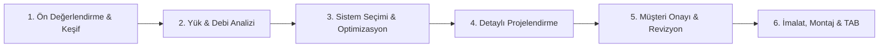

# Sky Group İklimlendirme & Havalandırma — Stratejik Dönüşüm Yol Haritası

> [!IMPORTANT]
> **Hedef Konumlandırma:** *"Türkiye’nin endüstriyel iklimlendirme ve havalandırma projelerinde mühendislik öncelikli, fabrika imalat güvencesiyle anahtar teslim çözüm ortağı."*

---

## 1. Yönetici Özeti ve Dönüşüm Matrisi

| Mevcut Durum (Önce) | Hedeflenen Durum (Sonra) | Stratejik Etki |
| :--- | :--- | :--- |
| Basit imalatçı ve montajcı algısı | Mühendislik danışmanı ve anahtar teslim taahhüt firması | İhale ve kurumsal projelerde karar verici güveni |
| 3 adımlı yüzeysel "Nasıl Çalışıyoruz?" | 6 aşamalı, standartlara dayalı (EN 1507, EN 1886), somut belgeli mühendislik süreci | Nitelikli lead ve yüksek hacimli teklif dönüşümü |
| Sadece logo ve genel yorum içeren referanslar | Challenge → Approach → Solution → Results yapısında detaylı Case Study'ler | Satış döngüsünü %40 kısaltan teknik ikna kabiliyeti |
| Dağınık ürün/hizmet listeleri | Sektör odaklı bilgi mimarisi (Endüstriyel, Sağlık, Plaza, AVM, Otopark, Gıda) | Mahal bazlı arama yapan hedef kitlenin anında yönlenmesi |
| Genel "Teklif Alın" formu | Multi-step "Ücretsiz Keşif & Debi Analizi Talep Et" lead hunisi | Aylık 40–80 yüksek değerli keşif talebi |

---

## 2. Yeni Bilgi Mimarisi (Information Architecture)

```mermaid
flowchart TD
    Home["Ana Sayfa (index.html)"] --> Cozumler["Sektörel Çözümler"]
    Home --> Hizmetler["Mühendislik & Hizmetler"]
    Home --> Projeler["Projeler & Case Studies"]
    Home --> Kurumsal["Kurumsal & Fabrika"]
    Home --> Kaynaklar["Teknik Kütüphane & Blog"]
    Home --> Iletisim["Keşif & İletişim"]

    Cozumler --> C1["Endüstriyel & Fabrika"]
    Cozumler --> C2["Sağlık & Temiz Oda"]
    Cozumler --> C3["Plaza / Ofis / Rezidans"]
    Cozumler --> C4["AVM / Otel / Ticari"]
    Cozumler --> C5["Otopark & Yangın Duman Tahliye"]
    Cozumler --> C6["Mutfak / Restoran"]

    Hizmetler --> H1["★ Projelendirme & Mühendislik Danışmanlığı (Amiral Sayfa)"]
    Hizmetler --> H2["Klima Santrali (AHU) İmalatı"]
    Hizmetler --> H3["Hava Kanalı İmalatı & Montaj (EN 1507 Class C)"]
    Hizmetler --> H4["VRF / VRV Sistemleri"]
    Hizmetler --> H5["Test, Ayar, Balanslama (TAB) & Devreye Alma"]
    Hizmetler --> H6["Periyodik Bakım & Servis"]

    Projeler --> P_Filter["Filtreli Vaka Çalışmaları (Challenge-Approach-Solution-Results)"]
    Kurumsal --> K_Fabrika["Üretim Tesisimiz & CNC Parkuru"]
    Kurumsal --> K_Sertifika["Sertifikalar (Eurovent, TSE, CE, ISO)"]
```



---

## 3. Profesyonel 6 Aşamalı Projelendirme & Danışmanlık Süreci

Aşağıdaki süreç, hem ana sayfada hem de oluşturulan bağımsız [`projelendirme-muhendislik-danismanligi.html`](file:///home/emre/Desktop/sky-group-new/projelendirme-muhendislik-danismanligi.html) sayfasında teknik derinliğiyle yer almaktadır:



### Aşamaların Ayrıntılı Kapsamı:

1. **Ön Değerlendirme & Yerinde Keşif**
   - **Kapsam:** Mimari ve mekanik DWG/BIM çizimlerinin incelenmesi, şantiyede tavan kotları, şaft geçişleri, statik yükler ve ortam havası parametrelerinin ölçümü.
   - **Standartlar:** TS EN 12599, İş Güvenliği ve Şantiye Değerlendirme Standartları.
   - **Müşteriye Teslim Edilen Belge:** *Detaylı Saha Keşif Raporu + Fotoğraf/Video ve Lazer Tarama Kaydı.*
   - **Süre:** 24 – 48 Saat.

2. **Mahal Bazlı Yük & Debi Analizi**
   - **Kapsam:** Mahal hacimleri, kişi sayısı, aydınlatma/cihaz ısı yükleri, taze hava oranları (CFM/m³/h), statik basınç kayıpları ve hava hızı simülasyonları.
   - **Standartlar:** ASHRAE 62.1, DIN 1946-4, EN 13779.
   - **Müşteriye Teslim Edilen Belge:** *Teknik Mühendislik Hesap Dosyası + Psikrometrik Diyagramlar + Alternatif Kapasite Senaryoları.*
   - **Süre:** 2 – 3 İş Günü.

3. **Sistem Seçimi & Enerji Verimliliği Optimizasyonu**
   - **Kapsam:** Mahal fonksiyonuna en uygun sistem mimarisinin (Klima Santrali + VRF + Isı Geri Kazanım HRV + Jet Fan / Duman Tahliye) seçimi, LCC (Ömür Boyu Maliyet) ve enerji tüketim simülasyonu.
   - **Standartlar:** Eurovent Certified Performance, ErP 2018 EcoDesign Direktifi, TSE EN 1886.
   - **Müşteriye Teslim Edilen Belge:** *Sistem Seçim Matrisi + Enerji Tüketim Projeksiyonu + Ön Maliyet Tablosu.*
   - **Süre:** 1 – 2 İş Günü.

4. **Detaylı Projelendirme & Metrajlı Şartname**
   - **Kapsam:** 3D koordinasyon çizimleri, kanal güzergâhı, menfez/anemostad dağılımı, yangın ve duman damperi yerleşimleri, ses yutucu hesapları, elektrik ve otomasyon arayüzleri.
   - **Standartlar:** EN 1507 Class C (Sızdırmazlık), SMACNA, TSE K 580.
   - **Müşteriye Teslim Edilen Belge:** *Metrajlı Teknik Şartname + DWG / Revit IFC Proje Paftaları + İmalat Kesim Listesi.*
   - **Süre:** 3 – 5 İş Günü.

5. **Müşteri Onayı, Bütçe & Revizyon Görüşmeleri**
   - **Kapsam:** Proje mühendislerimizle yüz yüze veya online teknik koordinasyon toplantısı; yatırım bütçesine göre değer mühendisliği (Value Engineering) ve revizyonlar.
   - **Standartlar:** ISO 9001:2015 Kalite Yönetimi.
   - **Müşteriye Teslim Edilen Belge:** *Nihai İmalat Projesi + Net Fabrika Teklif Dosyası + İmalat & Montaj Termin Takvimi.*
   - **Süre:** 1 – 2 İş Günü.

6. **Fabrika İmalatı, Saha Montajı & TAB (Test, Ayar, Balanslama)**
   - **Kapsam:** Otomatik CNC plazma ve flanş hatlarında sıfır toleransla üretim, şantiye montajı, diferansiyel basınç testleri, anemometre hava debisi kalibrasyonu ve resmi kabul.
   - **Standartlar:** EN 12599 TAB Standartları, TSE EN 1886 T2/TB2/L1/D1, NEBB İlkeleri.
   - **Müşteriye Teslim Edilen Belge:** *Akredite TAB Test & Balans Raporu + 2 Yıl Kapsamlı Garanti Belgesi + Tesis İşletme ve Bakım El Kitabı.*
   - **Süre:** Şantiye Termin Planına Göre.

---

## 4. Teknik Altyapı ve Platform Yol Haritası

```
+-----------------------------------------------------------------------------------+
| Faz 1 (Mevcut / Acil İcra):                                                      |
| - Statik HTML + Vite + BPC Framework güçlendirmesi                                |
| - 6 aşamalı Projelendirme sayfasının yayına alınması                              |
| - Ana sayfa #bcc-how bölümünün 6 adıma evrilmesi                                  |
| - Sektörel bilgi mimarisi ve multi-step form düzeni                               |
+-----------------------------------------------------------------------------------+
                                         │
                                         ▼
+-----------------------------------------------------------------------------------+
| Faz 2 (Modern Altyapıya Geçiş):                                                   |
| - Next.js (App Router) + TypeScript + Tailwind CSS                                |
| - Vercel veya Headless Node.js Barındırma                                         |
| - Headless CMS (Strapi / Sanity) ile dinamik Case Study & Teknik Kütüphane        |
| - Google Analytics 4 + Microsoft Clarity entegrasyonu                            |
+-----------------------------------------------------------------------------------+
                                         │
                                         ▼
+-----------------------------------------------------------------------------------+
| Faz 3 (İnteraktif Araçlar & Büyüme):                                              |
| - Web tabanlı Hızlı Debi & Kanal Kesiti Hesaplayıcı (Lead Magnet)                 |
| - Three.js / WebGL 3D Santral & Havalandırma Patlatılmış Görünümü                 |
| - B2B Müşteri Servis & Periyodik Bakım Talep Portalı                              |
+-----------------------------------------------------------------------------------+
```

---

## 5. Uygulama Adımları (Faz 1 Canlıya Alma)

- [x] Stratejik Yol Haritası ve Mimari Tasarım
- [x] [`projelendirme-muhendislik-danismanligi.html`](file:///home/emre/Desktop/sky-group-new/projelendirme-muhendislik-danismanligi.html) sayfasının üretilmesi (BasePower & İsviçre vitrin tasarımına %100 uyumlu)
- [x] [`index.html`](file:///home/emre/Desktop/sky-group-new/index.html) sayfasındaki `#bcc-how` bölümünün 6 aşamalı mühendislik sistemine güncellenmesi
- [x] Üst menü (Desktop mega-menü ve Mobil çekmece) navigasyon linklerinin yeni bilgi mimarisine uyarlanması
- [x] Hero CTA ve form başlıklarının *"Ücretsiz Keşif & Debi Analizi"* formatına dönüştürülmesi
- [x] Vite derlemesi (`npm run build`), medya yollarının kontrolü ve GitHub'a commit/push
